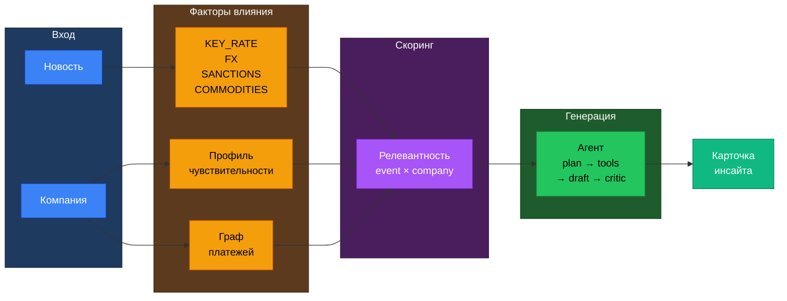

# Альфа-Хакатон 2026: Новостная аналитика для бизнес-решений

Сервис внутри интернет-банка **Альфа-Бизнес** для корпоративно-инвестиционного
бизнеса (КИБ). Для конкретной компании отбирает значимые события из новостного
потока, объясняет их влияние с учётом данных клиента и позиции Центра
макроэкономических исследований (ЦМИ) Альфа-Банка.

**Ключевая идея:** компании в данных обезличены, поэтому новость связывается
с клиентом не по названию, а через **факторы влияния** (ставка, курс, сырьё,
отрасль) + **граф платежей** (контрагенты клиента).



---

## Чем выделяемся (нужно обдумать )

- **Риск второго порядка через граф платежей.** Событие не касается клиента
  напрямую, но касается его покупателей или поставщиков. Данных нет ни у одного
  внешнего сервиса.
- **Автоматический профиль чувствительности** из банковских признаков (кредиты,
  депозиты, ВЭД, гарантии, зарплатный проект, ОКВЭД, выручка) — без ручной настройки.
- **Трёхцветная разметка тезисов:** 🟦 факт из новости / 🟥 позиция Альфа-Банка
  (с номером тезиса из отчёта ЦМИ) / 🟪 вывод AI (с уровнем уверенности).
- **Одна новость — разные выводы** для разных клиентов и разных ролей
  (финдиректор / казначей / гендиректор).
- **Видимый ход рассуждений агента** (трейс): какие инструменты вызваны,
  какие признаки сработали, что исправил критик.
- **Самопроверка:** критик проверяет, что у каждого тезиса есть источник,
  а позиция банка не выдумана.

---

## Стек

| Слой | Технология |
|---|---|
| Язык и зависимости | Python 3.11, uv (uv.lock) |
| API | FastAPI, uvicorn, Pydantic |
| БД | PostgreSQL 16 + pgvector, SQLAlchemy 2.0 |
| Данные и граф | pandas, NetworkX |
| Эмбеддинги | sentence-transformers, multilingual-e5 (локально) |
| Новости | feedparser, trafilatura, APScheduler |
| PDF (ЦМИ) | pymupdf |
| Шаблоны | Jinja2 |
| LLM | openai SDK (OpenAI-совместимый) |
| Фронт | Next.js, TypeScript, Tailwind |
| Запуск | Docker Compose |

**Разрешённые LLM**:

- **Gemma 4 26B** — классификация, извлечение (P1)
- **GLM-5.3-Flash** — интерпретация, критик (P5, P7)
- **Qwen3.6 35B** — чат, альтернатива для P5
- **DeepSeek-V4.1-Flash** — исследования, связи
- **Kimi-K2.6** — судья, оценка качества (P13)

---

## Структура репозитория

```
alfa-news-insights/
├── docker-compose.yml              db (pgvector) + api + web
├── .env.example
├── README.md
├── THIRD_PARTY_NOTICES.md
│
├── data/                           НЕ В GIT (конфиденциально)
│   ├── raw/                        CSV датасета организатора
│   ├── alfa_reports/               9 PDF ЦМИ
│   └── synthetic/                  demo_companies.json, тестовые аккаунты
│
├── backend/                        [Back-dev]
│   └── app/
│       ├── main.py                 FastAPI
│       ├── config.py
│       ├── database/               модели, репозитории, loader
│       ├── ingest/                 парсер RSS + гидратация
│       ├── enrichment/             LLM-обогащение новостей (P1)
│       ├── api/                    clients, feed, insight, trace, chat, analyze
│       └── security/               access, audit, masking
│
├── ml/                             
│   ├── profiles/                   матрица «признак → фактор», okved_map
│   ├── graph/                      граф контрагентов из платежей
│   ├── news/                       эмбеддинги, dedup, предфильтр
│   ├── ranking/                    скоринг релевантности
│   └── eval/                       golden_set, метрики
│
├── llm/                            
│   ├── client.py, budget.py, cache.py
│   ├── rag/                        индексация 9 PDF + retrieval
│   ├── agent/                      planner, tools, loop, trace
│   └── chat.py
│
├── prompts/                        
│   ├── taxonomy.md                 таксономия факторов
│   ├── schemas/                    event.json, insight.json, critic.json
│   ├── p1_classify.md … p13_judge.md
│   └── thesis_registry.csv         реестр тезисов ЦМИ
│
├── frontend/                       [Front-dev + Designer]
│   └── src/                        виджет, лента, карточка, трейс, чат
│
└── docs/                           [Product]
    ├── scenario.md, demo.md
    ├── checklist.md                чек-лист критериев
    ├── metrics.md, scaling.md
    └── pitch.pdf
```

---

## Быстрый старт

### 1. Окружение

```bash
python -m venv .venv
source .venv/bin/activate       # Windows: .venv\Scripts\activate
pip install -r requirements.txt
cp .env.example .env
# заполнить LLM_API_BASE, LLM_API_KEY
```

### 2. Данные

Положить в `data/` :

- `df_Uid_data_hack.csv` — компании (85K)
- `df_Uid_payment_hack.csv` — платежи (1.38M)
- `df_Fid_Uid_link_hack.csv` — физлица (12.5K)
- `alfa_reports/*.pdf` — 9 документов ЦМИ

### 3. Запуск

```bash
# Локально (SQLite)
python scripts/load_data.py       # датасет → БД (~2 мин)
python app/main.py                # новости + demo (~5 мин)
python scripts/enrich.py          # LLM-обогащение (~5 мин)

# Через Docker (когда всё готово)
docker compose up
```

---

## Роли и зоны ответственности

| Роль | Зона |
|---|---|
| **ML/LLM/Prompt** | Профили компаний, таксономия, промпты, реестр тезисов, критик, метрики |
| **ML/LLM Engineer** | Новостной конвейер, ранжирование, клиент к LLM, RAG, агент, чат |
| **Product** | Сценарий, критерии, правила действий, golden set, README, питч |
| **Back-dev** | Репозиторий, Docker, БД, парсер, API, безопасность, деплой |
| **Front-dev** | Интерфейс интернет-банка: виджет, лента, карточка, трейс, чат |
| **Designer** | Figma-макеты, визуальная система, презентация |

---

## Критерии успеха (12 из кейса)

1. Определяет бизнес-контекст клиента по данным
2. Использует аналитику ЦМИ, разделяет банк/AI
3. Отбирает, объединяет, суммирует материалы, сохраняет связь с источниками
4. Устойчивое качество на новых новостях
5. Полный сценарий: вход → персонализированная интерпретация
6. Содержательная интерпретация (риски, возможности, действия)
7. Масштабируется на новые отрасли, типы клиентов
8. Точка входа на главном экране Альфа-Бизнеса
9. Чат + другой разрез + первоисточник
10. Агентная логика (самостоятельные шаги, коррекция)
11. Трассируемость выводов
12. Метрики и мониторинг качества

---


## Ограничения

- **Бюджет LLM:** 500 ₽/день.
- **Локальные эмбеддинги** разрешены (multilingual-e5) — не тратят бюджет.
- **SQLite для разработки** — команда переезжает на Postgres + pgvector для эмбеддингов.
- **Гидратация CBR/PRIME** — ~4 минуты на первый прогон (дотягиваем полный текст).

---

## Конфиденциальность

Данные организатора (CSV, PDF ЦМИ, БД) — **конфиденциальны**:

- не коммитятся в git (`.gitignore`: `data/`, `*.csv`, `*.pdf`, `*.db`, `.env`);
- не передаются третьим лицам;
- не публикуются в открытом доступе.

**Репозиторий приватный**, доступ жюри: **`alfa-hack-2026`** (Read-only).

Итоговые решения (код, модели, предсказания) также конфиденциальны в соответствии
с п. 4.4.2 правил хакатона.

---

## Переменные окружения

```
DATABASE_URL=postgresql://postgres:postgres@db:5432/alfa
LLM_API_BASE=https://api.example.com/v1
LLM_API_KEY=...
LLM_MODEL_ENRICH=gemma-4-26b-a4b
LLM_MODEL_INSIGHT=glm-5.3-flash
DAILY_BUDGET_RUB=500
EMBEDDING_MODEL=intfloat/multilingual-e5-large
```
